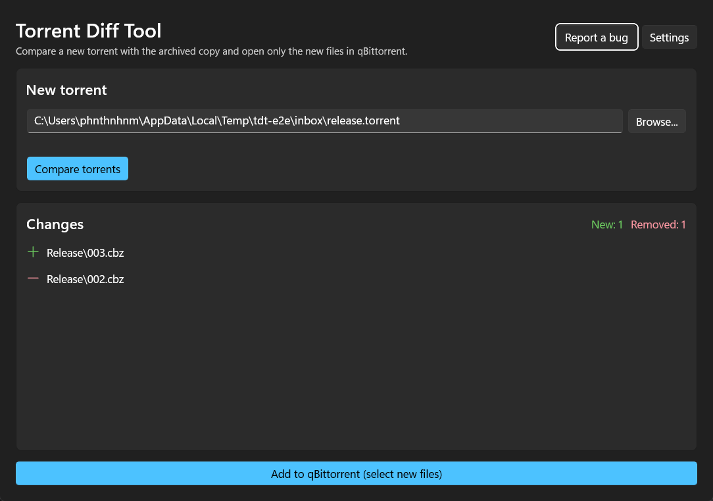

# Torrent Diff Tool

[](https://github.com/phnthnhnm/tdt/actions/workflows/ci.yml)

A Windows app that shows which files a new `.torrent` adds or removes compared
with the archived torrent of the same release, then hands only the new files to
qBittorrent.




## Why

Releases get re-packaged with a few chapters added and a few removed. Downloading
the whole torrent again wastes bandwidth and disk, and qBittorrent cannot compare
two torrent files. Torrent Diff Tool keeps the old `.torrent` next to your
downloads, diffs the file lists, and selects only the files that are actually new.

## Features

- File-level diff of two torrents: additions and removals side by side, in one
  list with counts.
- One command adds the new torrent to qBittorrent **paused** and selects only the
  new files — everything else stays at priority 0.
- Blacklist substrings (samples, extras, and so on) are never selected, and are
  listed in the confirmation dialog.
- qBittorrent authentication with a form login or a 5.2+ API key, HTTP or HTTPS.
- System, light and dark themes, applied to every open window immediately.
- Settings are a single JSON file; the qBittorrent password and API key are
  encrypted with Windows DPAPI before they touch disk.
- Timestamped settings backup and restore.
- Single instance per session; Windows 11 styling (Mica-free, standard title bar).

## Requirements

- Windows 10 version 1809 or later, or Windows 11, x64.
- qBittorrent with the WebUI enabled, for the "add to qBittorrent" step. Comparing
  torrents works without it.
- Nothing else: the release archive is self-contained and does not need the .NET
  runtime or the Windows App Runtime installed.

## Install

1. Download `tdt-<version>-windows-x64.zip` from
   [Releases](https://github.com/phnthnhnm/tdt/releases).
2. Extract it anywhere, for example `%LOCALAPPDATA%\Programs\tdt`.
3. Run `tdt.exe`.

The executable is not code-signed, so Windows SmartScreen may ask for
confirmation the first time. Choose "More info" and then "Run anyway".

## Usage

1. Open **Settings → Data** and choose the folder where you keep the previously
   downloaded `.torrent` files.
2. Open **Settings → qBittorrent** and enter the WebUI host and port with either
   the username and password or an API key. Save.
3. Click **Browse…** and pick the new `.torrent`.
4. Click **Compare torrents**. The list shows every added and removed file.
5. If files were added, click **Add to qBittorrent (select new files)**, review
   the confirmation, and confirm.

The old version is found by file name: the new `release.torrent` is compared with
`<data folder>\release.torrent`. Keep the name of the torrent file when you save
it.

### Blacklist

Files whose torrent path contains a blacklisted substring are never selected.
The default is empty; add entries such as `sample` or `extras` in
**Settings → qBittorrent**. Matching is case-insensitive and applies to the full
path inside the torrent.

## How the comparison works

- A torrent entry is identified by its path: the torrent name followed by each
  path segment. Two torrents with the same files but different root names
  therefore diff as a complete replacement.
- The diff is a set difference over those paths: additions are paths only in the
  new torrent, removals are paths only in the old one. Both lists are sorted.
- Equal paths with different sizes are not reported, and renames appear as one
  removal plus one addition.
- qBittorrent reports content paths that do not include the torrent root, so the
  selection step matches added files by file name.

## Settings and data

Settings live in a single file:

```
%APPDATA%\Tdt\settings.json
```

| Key | Meaning |
| --- | --- |
| `theme` | `System`, `Light` or `Dark` |
| `dataFolder` | Folder holding the archived torrent files |
| `qbittorrent.host`, `qbittorrent.port` | WebUI address |
| `qbittorrent.username`, `qbittorrent.password` | Form login |
| `qbittorrent.apiKey` | 5.2+ API key; when set, form login is never used |
| `qbittorrent.useHttps` | Use HTTPS for the WebUI |
| `qbittorrent.blacklist` | Substrings that are never selected |

The password and the API key are encrypted with DPAPI for the current Windows
account, so a copied settings file cannot be read on another account or machine.
For the same reason, restoring a backup on a different account keeps the other
settings but requires the credentials to be entered again.

**Settings → Data** can export the file to a timestamped JSON backup, restore it,
or reset every setting. Restoring validates the file before it replaces the
current settings.

## Development

Requirements:

- .NET SDK 11.0.100 or later (see `global.json`)
- Windows 10 SDK 10.0.26100, for example through Visual Studio 2026 with the
  ".NET Desktop Development" and Windows SDK components

```bash
dotnet restore tdt.slnx
dotnet build tdt.slnx -c Debug
dotnet test tdt.slnx
dotnet format tdt.slnx --verify-no-changes
```

Run the app:

```bash
dotnet run --project src/Tdt.App
```

Build the self-contained release archive:

```bash
dotnet publish src/Tdt.App/Tdt.App.csproj -c Release -r win-x64 \
  --self-contained -p:WindowsAppSDKSelfContained=true -o artifacts/publish
cd artifacts/publish && 7z a -tzip -mx=9 ../tdt-<version>-windows-x64.zip *
```

The archive is about 90 MB because it bundles the .NET and Windows App SDK
runtimes so users need no prerequisites.

### Layout

```
src/Tdt.Core      torrent parsing, diffing, qBittorrent client, settings
src/Tdt.App       WinUI 3 UI, view models, platform services
tests/            xUnit tests for Tdt.Core
docs/screenshots  README images
```

`Tdt.Core` has no UI dependency; the WinUI project only adds the views, the view
models and the platform glue. All HTTP requests go through a handler that logs
the method, URL and status only, never headers, so credentials cannot leak into a
log.

## Release process

Releases are automated with
[release-please](https://github.com/googleapis/release-please):

1. Merge Conventional Commits into `main`.
2. Release Please opens (and keeps updating) a `chore(main): release X.Y.Z` pull
   request that bumps `version.txt` and `Directory.Build.props` and updates
   `CHANGELOG.md`.
3. Merge that pull request. Release Please creates the `vX.Y.Z` tag and the
   GitHub release.
4. The published release triggers `.github/workflows/release.yml`, which builds
   the tag, zips it as `tdt-<version>-windows-x64.zip` and uploads it to the
   release.

`RELEASE_PLEASE_TOKEN` must be configured as a repository secret. A release
created with the default `GITHUB_TOKEN` does not trigger other workflows, so the
build would never run.

Never create tags or releases by hand.

## Troubleshooting

| Symptom | Fix |
| --- | --- |
| "Data folder not set in Settings" | Choose the folder in Settings → Data |
| "No matching old torrent found in data folder" | The old `.torrent` must have the same file name and live in the configured folder |
| "qBittorrent settings not configured" | Enter the host and port in Settings → qBittorrent |
| "qBittorrent error: qBittorrent login failed (403)" | Check the username and password, or use an API key |
| The torrent was added but everything is paused | That is intended: the app pauses and selects only the new files |
| Nothing is selected | The added paths may be blacklisted, or the torrents differ only by root name |
| SmartScreen blocks the app | The build is unsigned; use "More info" → "Run anyway" |
| The app does not start | Run it from its own folder; the archive must be extracted, not run from inside the zip |

## License

GNU Affero General Public License v3.0. See [LICENSE](LICENSE).
