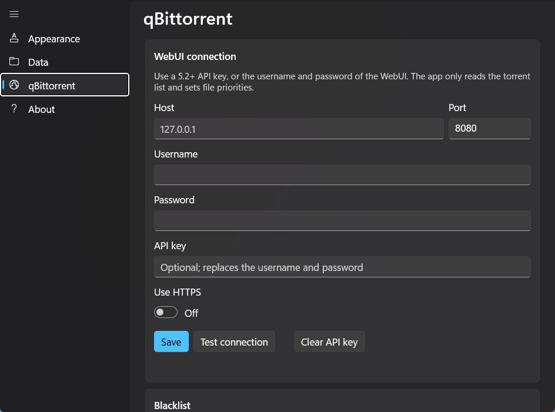

# Torrent Diff Tool

[](https://github.com/phnthnhnm/tdt/actions/workflows/ci.yml)


A Windows app that shows which files a new `.torrent` adds, removes or replaces
compared with the archived torrent of the same release, then hands only the files
that need downloading to qBittorrent.




## Why

Releases get re-packaged with a few chapters added, replaced or removed.
Downloading everything again wastes bandwidth and disk, and qBittorrent cannot
compare two torrent files. Torrent Diff Tool keeps the old `.torrent` next to
your downloads, diffs the file lists, and selects only what actually changed.

## Features

- Three-way file diff: **added**, **removed** and **changed** (same path,
  different size), with sizes and deltas.
- The archived torrent is found automatically: same file name first, then the
  same torrent name in the data folder, so a browser download named
  `release (1).torrent` still matches.
- Drag a `.torrent` onto the window, or use Ctrl+O.
- One command adds the release to qBittorrent **paused** and selects only the
  added and changed files; everything else stays at priority 0.
- Blacklist substrings (samples, extras, ...) are never selected and are listed
  in the confirmation dialog.
- **Test connection** in the settings checks the WebUI credentials before you
  need them; API key (qBittorrent 5.2+) or form login, HTTP or HTTPS.
- System, light and dark themes, including the title bar caption buttons.
- Settings are a single JSON file; the qBittorrent password and API key are
  encrypted with Windows DPAPI before they touch disk.
- Timestamped settings backup and restore; a settings file that cannot be read is
  kept beside the original instead of being overwritten.
- Native Windows 11 look: Mica backdrop, custom title bar, standard settings
  cards, remembered window size and position.
- Single instance per session.

## Requirements

- Windows 10 version 1809 or later, or Windows 11, x64.
- qBittorrent with the WebUI enabled, for the "add to qBittorrent" step. Comparing
  torrents works without it.
- Either the .NET 11 Desktop Runtime and the Windows App Runtime 2.6, or the
  standalone archive, which bundles both.

## Install

Every release publishes two portable archives. Nothing is installed and nothing
is written outside `%APPDATA%\Tdt`.

| Archive | Download | Requires |
| --- | --- | --- |
| `tdt-<version>-windows-x64.zip` | about 26 MB | .NET 11 Desktop Runtime and Windows App Runtime 2.6 |
| `tdt-<version>-windows-x64-standalone.zip` | about 90 MB | nothing else |

Take the small archive if those two runtimes are already on the machine;
otherwise take the standalone one.

1. Download one of the two archives from
   [Releases](https://github.com/phnthnhnm/tdt/releases).
2. Extract it anywhere, for example `%LOCALAPPDATA%\Programs\tdt`.
3. Run `tdt.exe`.

The executable is not code-signed, so Windows SmartScreen may ask for
confirmation the first time. Choose "More info" and then "Run anyway".

## Usage

1. Open **Settings → Data** and choose the folder where you keep the previously
   downloaded `.torrent` files.
2. Open **Settings → qBittorrent**, enter the WebUI host and port with either the
   username and password or an API key, and press **Test connection**.
3. Open the new `.torrent` with **Browse…**, Ctrl+O or drag and drop. The
   comparison runs immediately.
4. Review the changes, then press **Add to qBittorrent (paused)**.

### Keyboard shortcuts

| Shortcut | Action |
| --- | --- |
| `Ctrl+O` | Browse for a torrent |
| `Ctrl+Enter` | Compare again |
| `Esc` | Clear the comparison |

## How the comparison works

- A file is identified by its path **relative to the torrent root**, so a release
  that only renamed the root directory still compares cleanly.
- Added files exist only in the new torrent, removed files only in the archived
  one. A path present in both with a different size is a **change**: the release
  replaced the file, so it is downloaded again.
- Comparison is ordinal, so `001.CBZ` and `001.cbz` are different files.
- The archived torrent is looked up by file name first. If that misses, the data
  folder is scanned (up to 400 torrents, newest first) for a torrent with the same
  root name and a different info hash.
- The info hash is computed from the torrent, so the qBittorrent row is found
  exactly even if two torrents share a display name.
- qBittorrent reports content paths prefixed with the torrent root; the selection
  strips the root and compares case-insensitively, which keeps sibling folders
  such as `CD1/001.cbz` and `CD2/001.cbz` apart.

## Settings and data

Settings live in a single file:

```
%APPDATA%\Tdt\settings.json
```

| Key | Meaning |
| --- | --- |
| `theme` | `System`, `Light` or `Dark` |
| `dataFolder` | Folder holding the archived torrent files |
| `qbittorrent.host`, `qbittorrent.port` | WebUI address |
| `qbittorrent.username`, `qbittorrent.password` | Form login |
| `qbittorrent.apiKey` | 5.2+ API key; when set, form login is never used |
| `qbittorrent.useHttps` | Use HTTPS for the WebUI |
| `qbittorrent.blacklist` | Substrings that are never selected |
| `window` | Last window size and position |

The password and the API key are encrypted with DPAPI for the current Windows
account, so a copied settings file cannot be read on another account or machine.
For the same reason, restoring a backup on a different account keeps the other
settings but requires the credentials to be entered again.

A settings file that cannot be read is **not** overwritten: it is moved aside as
`settings.corrupt-<timestamp>.json` (or `settings.newer-<timestamp>.json` when it
was written by a newer version) and the app starts with defaults. **Settings →
Data** can export the file to a timestamped JSON backup, restore it, or reset
every setting. Restoring validates the file before it replaces anything.

## Development

Requirements:

- .NET SDK 11.0.100 or later (see `global.json`)
- Windows 10 SDK 10.0.26100, for example through Visual Studio 2026 with the
  ".NET Desktop Development" and Windows SDK components

```bash
dotnet restore tdt.slnx
dotnet build tdt.slnx -c Debug
dotnet test tdt.slnx
dotnet format tdt.slnx --verify-no-changes
dotnet run --project src/Tdt.App
```

Build both release archives locally (replace `0.2.0` with the version you want
stamped into the executable). Build the standalone one first:

```bash
dotnet publish src/Tdt.App/Tdt.App.csproj -c Release -r win-x64 \
  --self-contained true -p:WindowsAppSDKSelfContained=true \
  -p:Version=0.2.0 -o artifacts/standalone

dotnet publish src/Tdt.App/Tdt.App.csproj -c Release -r win-x64 \
  --self-contained false -p:WindowsAppSDKSelfContained=false \
  -p:Version=0.2.0 -o artifacts/portable
```

The order matters: the two publish modes must not share an intermediate
directory. A framework-dependent publish leaves a generated manifest behind that
makes the next self-contained publish skip its WinRT registration, and the
resulting app dies at startup. Either build the standalone first, or delete
`src/Tdt.App/obj` between the two commands. CI and the release workflow publish
each mode in its own job for this reason.

### Layout

```
src/Tdt.Core      torrent parsing, diffing, qBittorrent client, settings
src/Tdt.App       WinUI 3 UI, view models, platform services
tests/            xUnit tests for Tdt.Core
docs/             logo and README screenshots
```

`Tdt.Core` has no UI dependency. It owns the bencode parser, the info hash, the
three-way diff, the archived-torrent lookup, the qBittorrent client and session,
and the settings store. The WinUI project adds the views, the view models and the
platform glue. All HTTP requests go through a handler that logs the method, URL
and status only, never headers, so credentials cannot leak into a log.

## Release process

Releases are driven by tags. Pushing a tag that starts with `v` builds and
publishes both archives:

```bash
git tag -a v0.2.0 -m "v0.2.0"
git push origin v0.2.0
```

`.github/workflows/release.yml` then:

1. checks out the tag and stamps its version into the executable
   (`-p:Version=0.2.0`),
2. publishes the portable and the standalone build in separate jobs,
3. verifies that both contain `tdt.exe` and `tdt.pri`,
4. creates the GitHub release with notes generated from the commits since the
   previous tag, and attaches
   `tdt-<version>-windows-x64.zip` and
   `tdt-<version>-windows-x64-standalone.zip`.

The workflow uses the built-in `GITHUB_TOKEN`, so no repository secret is
needed. Re-running it for an existing tag rewrites the notes and replaces the
assets. `ci.yml` builds both archives on every qualifying push to `main`, so a
broken publish is caught before a tag is created. Dependabot opens weekly pull
requests for NuGet packages and GitHub Actions.

The tag is the only source of truth for the version; there is no version file to
bump. Tags are signed, so `git tag` needs `-a -m`.

## Troubleshooting

| Symptom | Fix |
| --- | --- |
| "Data folder not set in Settings" | Choose the folder in Settings → Data |
| "No archived torrent found for this release" | Put the old `.torrent` in the data folder; it matches by file name or by torrent name |
| "The data folder does not exist" | The configured folder was moved or deleted; choose it again |
| "qBittorrent settings not configured" | Enter the host and port in Settings → qBittorrent |
| "qBittorrent error: qBittorrent login failed (403)" | Check the username and password, or use an API key; **Test connection** reports the same result |
| The torrent was added but everything is paused | That is intended: the app pauses and selects only the changed files |
| Nothing is selected | The changed paths may be blacklisted |
| A file I did not expect is downloading | It changed size in the release, so it is treated as replaced |
| SmartScreen blocks the app | The build is unsigned; use "More info" → "Run anyway" |
| The small archive fails to start | Install the .NET 11 Desktop Runtime and Windows App Runtime 2.6, or use the standalone archive |
| Settings were reset after a crash | The unreadable file was kept as `settings.corrupt-<timestamp>.json` in `%APPDATA%\Tdt` |

## License

GNU Affero General Public License v3.0. See [LICENSE](LICENSE).
